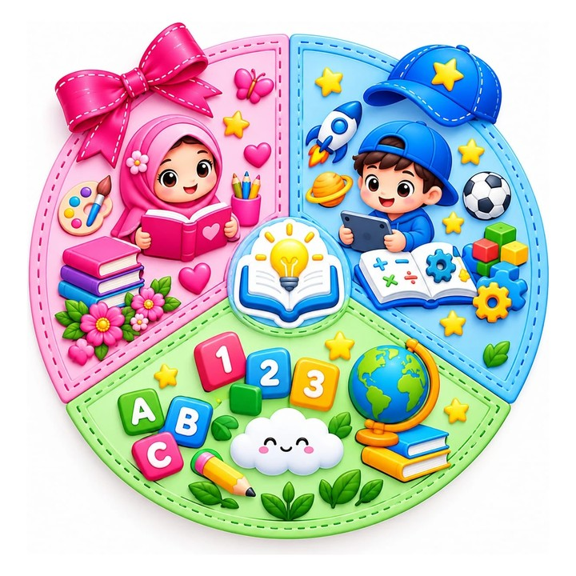

# 👑 ألعاب أثير وبشرى

<p align="center"></p>

تطبيق واحد يجمع **تسع عشرة لعبة** لأثير وبشرى. لكل لاعب ملفه الخاص (نتائجه ونجومه ومشترياته وإنجازاته)، وله ثيمان للواجهة: **👑 بناتي** و**🚀 ولادي**. الثيم يغيّر شكل القائمة والنوافذ فقط ولا يغيّر الألعاب.
يعمل **دون إنترنت**، بلا إعلانات ولا تتبّع، وكل البيانات داخل الجهاز.

## 📱 النسختان والتثبيت

للتطبيق نسختان **بألعاب متطابقة تمامًا**، ولا تختلفان إلا في الأسماء والشعار:

| النسخة | اللاعبون | الملف | الحزمة |
|---|---|---|---|
| ألعاب أثير وبشرى | أثير 👑، بشرى ⭐ | [`dist/AtheerBushra-4.0.apk`](dist/AtheerBushra-4.0.apk) | `com.atheer.games` |
| ألعاب كوتي وريلا وسونى | كوتي 🚗، ريلا 👑، سونى 🦖 | [`dist/KutiRilaSony-4.0.apk`](dist/KutiRilaSony-4.0.apk) | `com.kutirila.games` |

- لكل نسخة توقيع مختلف واسم حزمة مختلف، لذلك يمكن تثبيت النسختين معًا على الهاتف نفسه.
- التحديثات القادمة تُثبَّت فوق النسخة الموجودة مباشرة. النسخة 1.0 القديمة من «ألعاب أثير» تحتاج حذفًا مرة واحدة لأنها موقّعة بمفتاح مختلف.
- **ويب (PWA):** افتح `atheer/index.html` لنسخة أثير وبشرى.

```bash
python3 -m http.server 8000   # من جذر المستودع، ثم افتح http://localhost:8000/atheer/
```

## ✨ مزايا عامة

| الميزة | الوصف |
|---|---|
| 👤 لاعبان | أثير وبشرى، ولكل منهما نتائجه ونجومه منفصلة |
| 🎨 ثيمان | بناتي وردي أو ولادي أزرق، وتتغيّر صيغة النصوص (اختاري/اختر) حسب الثيم |
| ⚙️ الإعدادات | المؤثرات الصوتية، الموسيقى، الاهتزاز، حجم الخط، تبديل اللاعب، مسح النتائج |
| 🏆 الإنجازات | 30 إنجازًا، كل إنجاز يمنح 10 نجوم |
| 🎁 الهدية اليومية | نجوم كل يوم، وتزيد مع الأيام المتتالية |
| 🛍️ المتجر | أبطال فارس السحاب، رموز إكس أو، وكرات مطر الكرات |
| 🎵 موسيقى | لحن هادئ خاص بكل لعبة، مولّد داخل التطبيق |
| ❓ التعليمات | تظهر عند أول دخول لكل لعبة، ويمكن فتحها في أي وقت |

## 🎮 الألعاب

1. **☁️ فارس السحاب:** قفز عمودي لا نهائي. فيه أزرار ⬅️ ➡️، ودرع 🛡️ وصاروخ 🚀 يُشحنان بالنجوم، وطيور وغيوم رعدية وبالونات، وأربعة عوالم (السحاب ← قوس قزح ← القلعة ← الفضاء)، وخمسة أبطال.
2. **🌌 دمج الأجرام:** لعبة 2048 فضائية فيها تلميح 💡 وقنبلة 💥 وتبديل 🔀، وشبكات من 3×3 حتى 6×6، وتحدٍّ زمني مدته 3 دقائق، وموسوعة 📖 فيها معلومة عن كل جرم.
3. **✏️ إكس أو:** على سبورة بالطباشير. للذكاء ثلاثة مستويات (🐣 سهل، 🦊 متوسط، 🦁 لا يُقهر)، وفيها تراجع ↶، ولوحة 4×4، و🧠 إكس أو الخارقة، ورموز بديلة، وسلسلة «الأفضل من 5».
4. **🧱 قلعة المكعبات:** تيترس بقطع حلوى لامعة. فيها قطعة شبحية، وحفظ قطعة، وثلاث قطع تالية، وقلعة تُبنى مع كل مستوى، وأزرار كبيرة وإيماءات سحب.
5. **🫧 مدفع الفقاعات:** طابق 3 فقاعات أو أكثر من اللون نفسه. فيها خط تصويب يرتد عن الجدران، وحيوانات محبوسة تتحرّر، و20 مرحلة ثم وضع لا نهائي.
6. **⚽ مطر الكرات:** صوّب فتنطلق كل الكرات لتكسر مربعات مرقّمة. فيها كرات إضافية ونجوم، وزر تسريع ⏩، وأشكال كرات من المتجر.
7. **🔷 مطابقة الأشكال:** للأطفال الصغار. اسحب كل قطعة إلى مكانها: أشكال هندسية ثم حيوانات وفواكه ومركبات، مع نطق الاسم بالعربية و13 مستوى.
8. **🍬 الحلويات:** مطابقة ثلاثية، فيها حلوى مخطّطة وملفوفة وقوس قزح، وأهداف متنوّعة، وخريطة مستويات.
9. **🃏 بطاقات الذاكرة:** 30 مستوى، فيها مجموعة «صور العائلة» بصور حقيقية، ووضع لاعبين.
10. **🧪 أنابيب الألوان:** 60 مستوى مولّدة، وكل مستوى مُتحقَّق من أنه قابل للحل، مع تراجع وتلميح وأنبوب إضافي.
11. **🐛 الدودة الجائعة:** أوضاع كلاسيكي، وبلا جدران، ومغامرة من 15 مرحلة.
12. **🧩 ألغاز الصور المنزلقة:** شعار التطبيق، و7 صور عائلية، و11 لوحة مرسومة، بأحجام 3×3 و4×4 و5×5.
13. **🦋 صيد الفراشات:** تعلّم الألوان في 20 مستوى، مع حديقة حرة ينطق فيها اسم كل لون.
14. **✍️ حروفي:** تتبّع الحروف العربية الـ28 والإنجليزية الـ26 بالإصبع، مع النطق وكلمة تبدأ بكل حرف، واختبار «أين حرف…؟».
15. **🔢 أرقام وعدّ:** عدّ ومقارنة وجمع وطرح بالصور في 30 مستوى.
16. **🧭 المتاهة:** 40 متاهة تكبر تدريجيًا في خمسة عوالم.
17. **🔍 ابحث عن الاختلافات:** 16 مشهدًا مرسومًا، وفي كل صورة 5 فروق تتغيّر مع كل لعبة.
18. **🚕 التاكسي المرح:** تاكسي بعيون وأنف مضحك يقفز فوق العوائق ويجمع النجوم ويوصل الركاب.
19. **🎂 زينة الكيك:** تختار الشكل والطبقات والنكهة، وتصب الكريمة وترسم بها، وتضيف الكرز والشموع، وفيها طلبات للزبائن.

**مراحل جديدة في الإصدار 3.0:** مدفع الفقاعات (40 مرحلة)، مطابقة الأشكال (28 مستوى)، الحلويات (40 مستوى)، فارس السحاب (عالمان جديدان)، قلعة المكعبات (وضع «تحديات» من 12 تحديًا).

من إنتاج **البشرى تكنولوجي**.

## 🛠️ البناء

```bash
bash atheer/android/build-apk.sh          # يبني النسختين معًا في atheer/dist/
bash atheer/android/build-apk.sh kids3    # نسخة واحدة فقط (atheer أو kids3)
```
يحتاج: `aapt2` · `javac` · `zipalign` · `apksigner` · `android.jar`، ومُجمِّع DEX من `android/tools/`.

> **مفاتيح التوقيع:** `atheer/android/atheer.keystore` و`atheer/editions/kids3/kids3.keystore` محفوظان في المستودع كي تُثبَّت كل نسخة جديدة فوق القديمة. إذا أصبح المستودع عامًا فانقلهما إلى مكان خاص، ومرّرهما عبر `KEYSTORE`/`KEYSTORE_PASS` و`KEYSTORE_KIDS3`/`KEYSTORE_KIDS3_PASS`.

| المسار | الوظيفة |
|---|---|
| `index.html` | الواجهة الرئيسية والأنماط المشتركة |
| `js/edition.js` | أسماء اللاعبين واسم التطبيق للنسخة الافتراضية |
| `editions/kids3/` | ملفات نسخة كوتي وريلا وسونى: الأسماء، والشعار، والأيقونات، والمفتاح |
| `js/core.js` | اللاعبون، الثيمات، الأصوات والموسيقى، النجوم، المتجر، الإنجازات |
| `js/*.js` | لعبة في كل ملف |
| `logo.jpg` · `icon-*.png` | الشعار والأيقونات |
| `android/` | غلاف أندرويد (مع النطق العربي) وسكربت البناء |
| `dist/` | ملف APK الجاهز |
